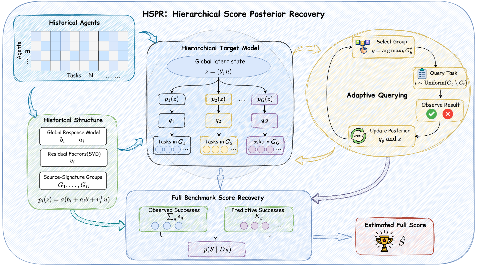
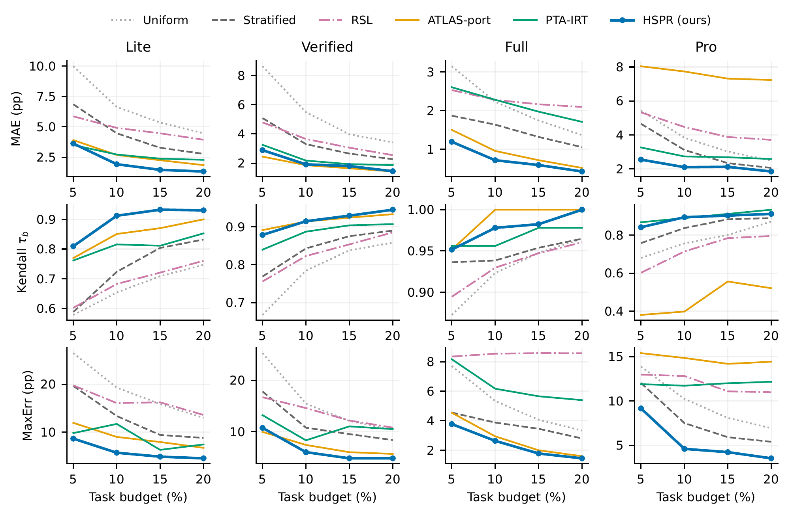

# HSPR

**Estimate software-agent benchmark scores from fewer task executions.**

[](https://arxiv.org/abs/2610.24611)
[](LICENSE)

[Paper](https://arxiv.org/abs/2610.24611) · [Code](https://github.com/wanyichen06/HSPR) · [Project website](https://wanyichen06.github.io/HSPR/) · [Quick start](#quick-start) · [Citation](#citation)

Official implementation of **HSPR: Recovering Software-Agent Benchmark Scores via Hierarchical Posterior Inference** (arXiv, 2026).

At a **10% task budget** across four SWE-bench task banks, HSPR has the lowest mean absolute error on three banks and the lowest maximum absolute error on all four among the paper's compared methods. The budget counts distinct queried tasks. See the [paper, Table 1](https://arxiv.org/html/2610.24611v1#S4.T1) for results and evaluation scope.

## How it works

HSPR learns response patterns from historical agents, updates a hierarchical posterior after each queried outcome, and selects the next task to reduce uncertainty. It estimates the full-benchmark score using a calibrated posterior-predictive median.

1. **Learn from historical responses.** Fit response factors and group tasks with identical historical outcome patterns.
2. **Query the new agent adaptively.** Reveal one selected task outcome at a time and update uncertainty about the agent and its task groups.
3. **Recover the full score.** Combine observed successes with predictions for unqueried tasks. Configuration selection and calibration use source agents only.

[](https://arxiv.org/html/2610.24611v1#S3)

*Method diagram from Figure 2 of the paper.*

The implementation runs on CPU with NumPy and SciPy. This repository contains the method, source-only configuration selection, the 16 paper fold configurations, and small runnable examples and tests.

## Results

[](https://arxiv.org/html/2610.24611v1#S4)

*Published budget-sensitivity results (Figure 3). Each column is a task bank. Lower MAE and MaxErr are better; higher Kendall rank correlation is better. Errors are in percentage points. HSPR keeps its 10% source-selected settings and extends the same query paths across budgets; baselines retain their saved budget-specific settings. FAQ-port and Mid-Range results are reported separately in Table 1. The paper describes the FAQ and ATLAS adaptations.*

## Paper

**[HSPR: Recovering Software-Agent Benchmark Scores via Hierarchical Posterior Inference](https://arxiv.org/abs/2610.24611)**

Wanyi Chen¹, Wanqin Shen¹, Yuanchen Shi¹, Zhensu Sun², Fang Kong¹†

¹ Soochow University · ² Singapore Management University

† Corresponding author

The paper evaluates score recovery on SWE-bench Lite, Verified, Full, and Pro. The experiments replay recorded task outcomes: each selected query reveals a saved success or failure, and HSPR estimates the agent's score over the whole task bank. You can run this evaluation on CPU using the public data below. No LLM API key is needed.

## Quick start

Python 3.11:

```bash
git clone https://github.com/wanyichen06/HSPR.git
cd HSPR
python -m venv .venv
source .venv/bin/activate
pip install -r requirements.txt
python example.py
python smoke_test.py
```

`example.py` fits HSPR to a small synthetic response matrix and queries four target tasks. It requires no downloaded data. Its settings illustrate the API; paper settings are in `paper_configs.json`.

The smoke test checks the predictive distribution, invariance to unqueried outcomes, nested query paths, and exact recovery at full budget.

## Evaluate HSPR on the published datasets

The paper uses public task-outcome data released by [PTA-IRT](https://github.com/DeepSoftwareAnalytics/PTA-IRT/tree/b38263b72f3c4a52fcc8fe478e1eae385ba423a6). Download `data.zip` from that repository at commit `b38263b72f3c4a52fcc8fe478e1eae385ba423a6` and extract it. Pass the directory containing these four folders to `--data-root`:

```text
data/
  swe_lite_summary/{matrix.csv,metadata.json}
  swe_verified_summary/{matrix.csv,metadata.json}
  swe_test_summary/{matrix.csv,metadata.json}
  swe_pro_summary/{matrix.csv,metadata.json}
```

In `matrix.csv`, each row is an agent configuration, each column is a task, and each value is a recorded outcome: **1 = success, 0 = failure**. `metadata.json` identifies the agent configuration for each row. `paper_configs.json` specifies which rows provide historical data and which rows are held out for evaluation in each fold.

For example, on the 300-task Lite bank, a 10% budget reveals 30 outcomes from a held-out agent's row. HSPR uses those outcomes and the historical agents' rows to estimate the held-out agent's mean over all 300 tasks. The remaining target outcomes stay hidden during selection and estimation; afterward, the complete row supplies the true score for measuring error.

Start with one target in one fold:

```bash
python run_hspr.py --data-root data --benchmark lite --folds 0 \
  --seeds 0 --limit-targets 1 --workers 1 --output outputs/lite-check.json
```

Run the four paper banks with the released source-selected configurations:

```bash
python run_hspr.py --data-root data --benchmark all --workers 4 \
  --output outputs/hspr.json
```

The default HSPR query seeds are 0–4, matching the paper. Budgets count distinct queried task outcomes. Scores and errors in JSON use a 0–1 scale; multiply by 100 for percentage points.

Scan the paper budgets:

```bash
python run_hspr.py --data-root data --benchmark all --workers 4 \
  --fractions .05 .10 .15 .20 --output outputs/budgets.json
```

The runner refits item/group parameters using only each fold's source agents. Refit numerical paths can vary across numerical environments. The saved configurations preserve the paper's source/target splits and selected settings; fitted parameter snapshots and archived predictions are omitted from this code-only release.

## Select configurations from source data

```bash
python select_source.py --data-root data --benchmark lite --fold 0 \
  --output outputs/lite-fold0-config.json
python run_hspr.py --data-root data --benchmark lite --folds 0 \
  --config outputs/lite-fold0-config.json --output outputs/lite-fold0.json
```

Configuration selection uses leave-one-agent-out validation within the source set and can take substantially longer than replay with released settings. Target outcomes enter the evaluator only when queried; full outcomes are accessed afterward for scoring.

Use `--help` for component controls such as posterior mean, fixed Score acquisition, Latent acquisition, and removal of group uncertainty. This release focuses on HSPR; the paper's external baseline implementations and historical experiment archives remain separate.

## Citation

```bibtex
@article{chen2026hspr,
  title={HSPR: Recovering Software-Agent Benchmark Scores via Hierarchical Posterior Inference},
  author={Chen, Wanyi and Shen, Wanqin and Shi, Yuanchen and Sun, Zhensu and Kong, Fang},
  journal={arXiv preprint arXiv:2610.24611},
  year={2026},
  doi={10.48550/arXiv.2610.24611},
  url={https://arxiv.org/abs/2610.24611}
}
```

Machine-readable citation metadata is available in [CITATION.cff](CITATION.cff).

## License

Code: [MIT](LICENSE). The two figures are reproduced from the [paper](https://arxiv.org/abs/2610.24611), published under [CC BY 4.0](https://creativecommons.org/licenses/by/4.0/). They are rendered as PNG images for display here.
